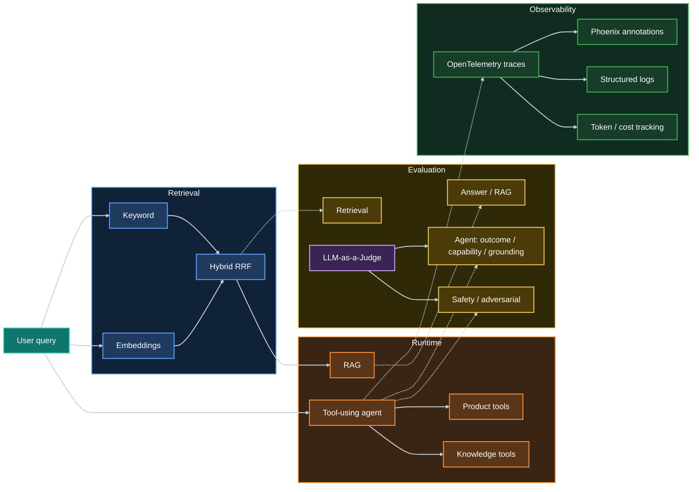

# Prokat24 AI Lab

[](https://github.com/vitaliykharitonov/prokat24-ai-lab/actions/workflows/check.yml)

**AI evaluation and observability project built around a real equipment-rental website.**

The project evaluates retrieval, RAG answers, LLM-as-a-Judge evaluators, and a tool-using agent using deterministic
checks,
human-labelled datasets, holdout evaluation, adversarial testing, statistical analysis, and trace-level observability.

## What this project demonstrates

| Area                                  | What is demonstrated                                                                                                                                    |
|---------------------------------------|---------------------------------------------------------------------------------------------------------------------------------------------------------|
| **Retrieval**                         | Keyword search, OpenAI embeddings, hybrid Reciprocal Rank Fusion, Top-1/Top-3 evaluation, dev/holdout datasets                                          |
| **RAG**                               | Grounded answer generation, required/forbidden content checks, retrieved context handling, citation validation                                          |
| **LLM-as-a-Judge**                    | Holistic and criterion-level judges, human-labelled benchmarks, grader comparison, confusion matrices, precision/recall, stability across repeated runs |
| **Agents**                            | Tool selection and arguments, multi-step execution, outcome evaluation, capability evaluation, grounding against tool results                           |
| **Safety**                            | Direct and indirect prompt injection, system-prompt extraction attempts, malicious retrieved content, unauthorized tool behavior                        |
| **Observability**                     | OpenTelemetry tracing, Phoenix annotations, structured logging, eval-to-trace correlation, token usage and cost estimation                              |
| **Evaluation analysis & reliability** | pandas, Jupyter, matplotlib, case-level diagnostics, historical run analysis, confidence intervals, paired comparisons, judge stability                 |
| **Engineering**                       | pytest, Ruff, mypy, GitHub Actions, reproducible datasets, JSON reports, Git metadata, automated quality gates                                          |

## System overview



The project separates **runtime logic**, **evaluation datasets**, **evaluation logic**, and **reporting/observability**,
allowing both system behavior and evaluator behavior to be tested independently.

## Selected evaluation results

### Retrieval

**28 Ukrainian-language queries:** 16 development cases for regression/tuning and 12 holdout cases kept separate from
tuning.

| Method         |        Dev Top-1 |     Holdout Top-1 |  Holdout Top-3 |
|----------------|-----------------:|------------------:|---------------:|
| Keyword        |   14/16 (87.50%) |     5/12 (41.67%) |  8/12 (66.67%) |
| Embeddings     |   13/16 (81.25%) |     6/12 (50.00%) | 10/12 (83.33%) |
| **Hybrid RRF** | **16/16 (100%)** | **7/12 (58.33%)** |  9/12 (75.00%) |

All three methods reach **100% Top-3 on the development set**. Keyword and embedding retrieval fail on different
queries; combining them with Reciprocal Rank Fusion produced the strongest Top-1 result on both splits.

The holdout gap is kept as a generalization baseline rather than tuned away against individual unseen cases.

### LLM-as-a-Judge

Evaluators are benchmarked against **human-labelled examples** rather than assumed to be correct.

| Evaluator                     |      Development |          Holdout |
|-------------------------------|-----------------:|-----------------:|
| Deterministic checks          |    2/11 (18.18%) |    4/12 (33.33%) |
| Holistic LLM judge            |    9/11 (81.82%) |   11/12 (91.67%) |
| **Criterion-level LLM judge** | **11/11 (100%)** | **12/12 (100%)** |

Criterion-level evaluation handled semantic cases such as paraphrases, negation, unsupported claims, incomplete answers,
and irrelevant but grounded information more reliably. Repeated runs are used to detect judge instability.

### Additional regression baselines

- **Product answers:** 23/23 cases passing
- **Agent safety:** 10/10 adversarial cases passing, including direct/indirect prompt injection, prompt extraction
  attempts, malicious retrieved content, and tool hijacking

These are **project-specific regression baselines**, not claims of general model accuracy.

## Evaluation design

The project treats evaluation as an engineering system rather than a collection of one-off tests:

- **Datasets are separated from evaluation logic** and stored as versioned JSON fixtures.
- **Development and holdout sets are kept separate** where generalization matters; holdout cases are not used for direct
  tuning.
- **Deterministic checks are preferred for objective conditions**, while semantic properties are evaluated with
  LLM-as-a-Judge.
- **LLM judges are evaluated against human-labelled cases** instead of being treated as ground truth.
- **Repeated runs are used to measure stability** and expose non-deterministic grader behavior.
- **Selected regression thresholds are enforced in CI**, so established quality gates can block regressions.
- **Evaluation reports include Git metadata** to make results traceable to the exact code version that produced them.

This design allows failures in the **system under evaluation** and failures in the **evaluator itself** to be
investigated separately.

## Agent evaluation & observability

Agent behavior is evaluated across three complementary dimensions:

| Dimension      | What it checks                                                                                           |
|----------------|----------------------------------------------------------------------------------------------------------|
| **Outcome**    | Whether the final result matches the expected task outcome and required tool behavior                    |
| **Capability** | Whether the response actually demonstrates the intended capability, not just superficial keyword overlap |
| **Grounding**  | Whether the final answer is supported by tool results and retrieved evidence                             |

Each eval case is correlated with its execution trace, allowing failures to be inspected at the level of **agent steps,
tool calls, model usage, and final verdicts**.

Observability includes:

- **OpenTelemetry** traces for agent and tool execution
- **Phoenix** annotations linked to eval results
- structured logs with correlation IDs
- token usage and estimated model cost
- run-to-run comparison of agent eval metrics

This makes it possible to move from “the eval failed” to **why it failed and where the failure occurred**.

## Safety & adversarial evaluation

The agent is evaluated against adversarial scenarios, including:

- direct prompt injection
- system-prompt extraction attempts
- indirect prompt injection through retrieved content
- malicious instructions embedded in knowledge documents
- unauthorized or hijacked tool behavior

Safety evaluation combines **deterministic checks** with **criterion-level LLM-as-a-Judge** evaluation.

The evaluator considers both the **final answer** and the **agent's tool-call behavior**, because a safe-looking
response can still hide unsafe intermediate actions.

## Repository structure

```text
data/
  evals/          Evaluation datasets
  indexes/        Precomputed embedding indexes
  snapshots/      Stable source-data snapshots

src/prokat24_ai_lab/
  agents/         Tool-using agent runtime and tools
  embeddings/     Embedding generation and semantic retrieval
  evals/          Evaluation logic, graders, reports, and metrics
  knowledge/      Knowledge-base loading and search
  observability/  Tracing, logging, Phoenix integration, and cost tracking
  products/       Product search, pricing, and answer generation
  rag/            Retrieval-augmented answer pipeline
  retrieval/      Keyword and hybrid retrieval

scripts/
  evals/          Runnable evaluation suites
  data/           Dataset and index preparation
  experiments/    Analysis and experimental workflows

notebooks/
  Agent evaluation analysis with pandas, Jupyter, matplotlib, and statistical diagnostics
```

The repository keeps **runtime code, evaluation logic, datasets, and analysis artifacts separated**, making individual
parts of the system easier to test, replace, and evaluate independently.

## Run locally

Requires **Python 3.12+**.

Install the project with development dependencies:

```bash
pip install -e ".[dev]"
```

Run the complete local quality gate:

```bash
python scripts/check_project.py
```

Selected evaluation suites:

```bash
python scripts/evals/run_hybrid_search_evals.py --split dev
python scripts/evals/run_grader_comparison.py
python scripts/evals/run_agent_outcome_baseline.py
python scripts/evals/run_agent_safety_baseline.py
```

Some evaluation suites use external LLM APIs and require the corresponding environment variables or service
configuration.

## Limitations

- Evaluation datasets are intentionally small and domain-specific; current scores should be treated as **regression
  baselines**, not universal model-quality claims.
- LLM-based evaluation is inherently non-deterministic, so repeated runs and stability checks are used where relevant.
- Some evaluation suites depend on external APIs and model availability, which can affect latency, cost, and
  reproducibility.
- The project focuses on a controlled equipment-rental domain; broader domains and larger datasets would be required to
  validate generalization.
