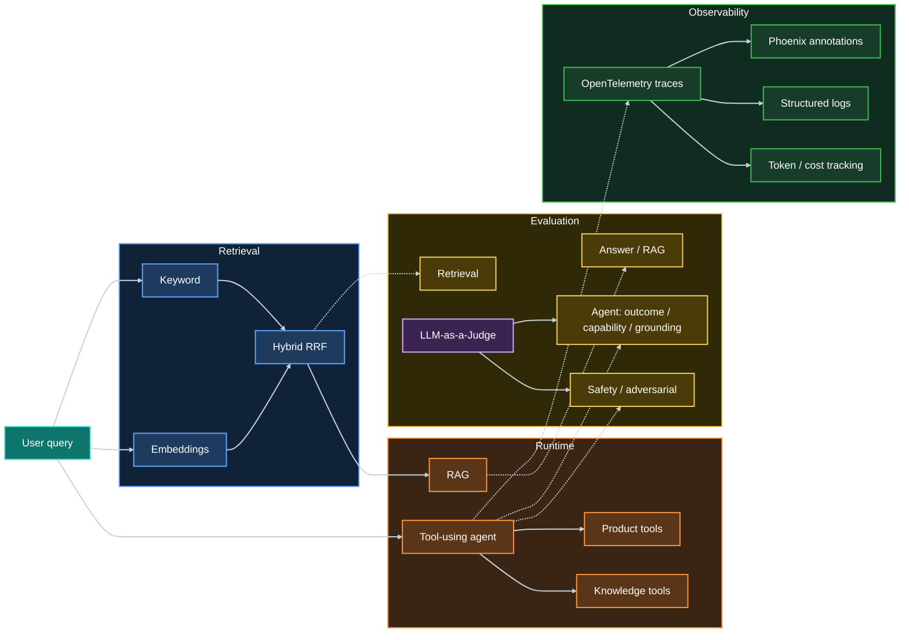

# Prokat24 AI Lab

**AI evaluation and observability project built around a real equipment-rental website.**

The project evaluates retrieval, RAG answers, LLM-as-a-Judge systems, and a tool-using agent using deterministic checks,
human-labelled datasets, holdout evaluation, adversarial testing, statistical analysis, and trace-level observability.

## What this project demonstrates

| Area                                  | What is demonstrated                                                                                                                                    |
|---------------------------------------|---------------------------------------------------------------------------------------------------------------------------------------------------------|
| **Retrieval**                         | Keyword search, OpenAI embeddings, hybrid Reciprocal Rank Fusion, Top-1/Top-3 evaluation, dev/holdout datasets                                          |
| **RAG**                               | Grounded answer generation, required/forbidden content checks, retrieved context handling, citation validation                                          |
| **LLM-as-a-Judge**                    | Holistic and criterion-level judges, human-labelled benchmarks, grader comparison, confusion matrices, precision/recall, stability across repeated runs |
| **Agents**                            | Tool selection and arguments, multi-step execution, outcome evaluation, capability evaluation, grounding against tool results                           |
| **Safety**                            | Direct and indirect prompt injection, system-prompt extraction attempts, malicious retrieved content, unauthorized tool behavior                        |
| **Observability**                     | OpenTelemetry tracing, Phoenix annotations, structured logging, eval-to-trace correlation, token usage and cost estimation                              |
| **Evaluation analysis & reliability** | pandas, Jupyter, matplotlib, case-level diagnostics, historical run analysis, confidence intervals, paired comparisons, judge stability                 |
| **Engineering**                       | pytest, Ruff, mypy, GitHub Actions, reproducible datasets, JSON reports, Git metadata, automated quality gates                                          |

## System overview

The project separates **runtime logic**, **evaluation datasets**, **evaluation logic**, and **reporting/observability**,
allowing both system behavior and evaluator behavior to be tested independently.
